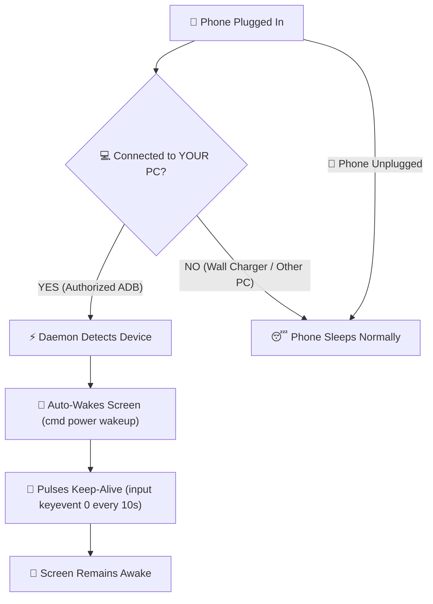

# Android PC Keep-Awake ⚡📱

[](https://microsoft.com/windows)
[](https://android.com)
[](https://github.com/PowerShell/PowerShell)
[](LICENSE)

A lightweight, production-grade Windows daemon that keeps your Android phone awake **strictly when connected to your specific laptop or PC**.

When unplugged, or when plugged into a normal wall charger, power bank, or another computer, your phone sleeps normally according to its factory display timeout.

---

## 💡 The Problem

Android has a developer setting called *"Stay awake while charging"*. The major issue is that once turned on, it keeps the screen awake on **every single power source**:
* Wall chargers & fast TurboPower adapters
* Power banks
* Other laptops (e.g., at work, school, or in public)

If you only want your phone awake when sitting on your desk plugged into **your own PC** (to monitor notifications, debugging logs, music controls, or dashboards), Android provides no native way to specify a trusted host computer.

---

## 🚀 The Solution

`android-pc-keep-awake` runs as an ultra-lightweight, invisible background service on **your PC**:



1. **PC-Exclusive:** Only your authorized laptop or PC communicates with the device.
2. **Instant Wake on Reconnect:** The second you plug your phone in, it immediately wakes the display.
3. **Lockscreen Aware:** Prevents the standard Android 5-to-8 second lock screen timeout by gently pulsing non-intrusive user-activity signals.
4. **Self-Healing Reconnections:** If a rapid cable disconnect causes a stale ADB socket, the daemon automatically detects the physical USB hardware and re-attaches (`adb reconnect`).
5. **Timeout Protection:** Every ADB transaction is guarded with an asynchronous 5-second timeout to prevent hung processes.
6. **Zero Side Effects:** Leaves the phone's global `stay_on_while_plugged_in` setting at `0` (factory default). Unplugging immediately restores normal sleep behavior.
7. **No 3rd-Party Phone Apps Needed:** Pure host-side ADB automation. No apps running on your phone, no battery drain, and no root required.
8. **Featherweight:** Consumes **0.0% CPU** and less than **5 MB of RAM** on Windows.

---

## 📋 Requirements

* **Windows 10 or 11**
* **Android phone** (Android 8.0 through Android 15+) with **USB Debugging** enabled
* **USB Cable** (data-capable)

---

## ⚡ Quick Start

### Step 1: Enable USB Debugging on your Phone
1. Open **Settings > About phone** and tap **Build number** 7 times until you see *"You are now a developer!"*.
2. Go to **Settings > System > Developer options** and turn **USB debugging** to **ON**.
3. Connect your phone to your PC with a USB cable. Unlock the phone, check **"Always allow from this computer"**, and tap **Allow**.

### Step 2: Clone and Install
Open PowerShell and run:

```powershell
git clone https://github.com/HIMANK9506/android-pc-keep-awake.git
cd android-pc-keep-awake
powershell -ExecutionPolicy Bypass -File .\install.ps1
```

The installer will:
* Detect or install ADB via `winget` (if not already installed).
* Auto-detect your connected Android device.
* Generate `config.json`.
* Register a silent auto-start shortcut in your Windows Startup folder.
* Launch the background daemon immediately.

---

## 📊 Live Diagnostics (`status.bat`)

Double-click **`status.bat`** (or run `powershell -File .\status.ps1`) anytime to inspect real-time system health:

```text
=====================================================
       Android PC Keep-Awake - Live Diagnostics      
=====================================================

[Daemon]
  Status:        RUNNING
  Process ID:    7096
  Memory Usage:  4.12 MB

[Windows Startup]
  Auto-Start:    ENABLED
  Shortcut:      ...\Startup\PhoneKeepAwake.lnk

[Android Device]
  Connected:     YES
  Device ID:     ZA223PXXMC
  Model:         motorola edge 70 fusion
  Battery:       91% (Charging)
  Screen State:  AWAKE (Screen On)

[Recent Activity Log]
  [2026-11-04 15:44:50] [INFO] Daemon initialized. ADB path: ...
  [2026-11-04 15:44:51] [INFO] Device connected and authorized: ZA223PXXMC
```

---

## ⚙️ Configuration (`config.json`)

Settings are stored in `%USERPROFILE%\.phone-keep-awake\config.json`:

```json
{
  "targetDeviceId": "ZA223PXXMC",
  "intervalSeconds": 10,
  "autoWakeOnConnect": true,
  "enableLogging": true,
  "maxLogSizeBytes": 1048576
}
```

| Setting | Default | Description |
| :--- | :--- | :--- |
| `targetDeviceId` | `""` | Device serial number. If blank, auto-detects the first connected authorized device. |
| `intervalSeconds` | `10` | Frequency (in seconds) of the keep-alive pulse. |
| `autoWakeOnConnect`| `true` | Automatically wakes the screen if off/dozing upon plugging in. |
| `enableLogging` | `true` | Writes timestamped events to `daemon.log`. |
| `maxLogSizeBytes` | `1048576` | Log rotation limit (default: 1 MB). |

---

## 🛠️ Management & Controls

| Action | Command / Shortcut |
| :--- | :--- |
| **Check Live Status** | Double-click `status.bat` or run `.\status.ps1` |
| **Stop Daemon** | Double-click `stop-watcher.bat` |
| **Complete Uninstall** | Run `powershell -ExecutionPolicy Bypass -File .\uninstall.ps1` |

---

## ❓ Troubleshooting FAQ

### 1. The phone prompt says "unauthorized"
Unlock your phone screen, check the box **"Always allow from this computer"**, and tap **Allow**.

### 2. My phone turns off when connected
Run `status.bat`. If `Physical USB: DETECTED` but `Connected: NO`, your phone may be in *"No data transfer / Charging only"* mode. Swipe down from your phone's notification shade, tap **USB Preferences**, and select **File Transfer / Android Auto**.

### 3. OLED Screen Protection
Modern OLED displays (such as pOLED) have built-in pixel shifting. However, for maximum panel longevity, avoid leaving static bright images on 100% brightness 24/7. Using an ambient lock screen clock or medium brightness is recommended.

---

## 🔒 Security & Privacy

* Uses official Google Android Debug Bridge (`adb.exe`).
* Communications are protected by your PC's unique RSA cryptographic keypair.
* Untrusted computers cannot interact with your phone without manual confirmation.
* Does not root, alter firmware, or modify system partitions.

---

## 📄 License

This project is licensed under the [MIT License](LICENSE) - Copyright (c) 2026 HIMANK9506.
